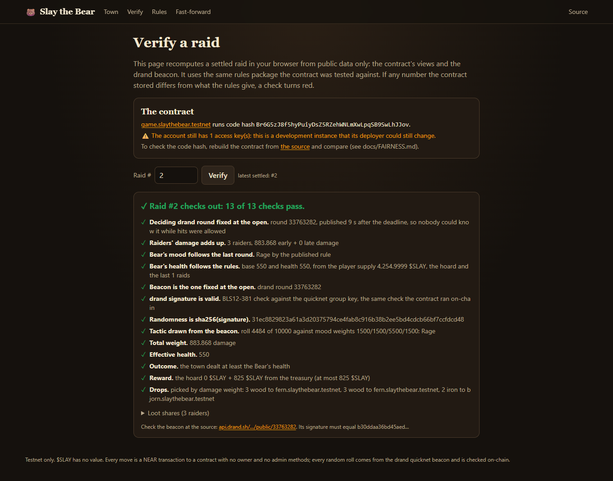

# Slay the Bear

A memecoin and a town game in one NEAR contract. Players burn $SLAY to hit the Bear before the
timer runs out. If the town's damage reaches the Bear's health, the raiders split its hoard and
a treasury reward by damage. If not, the Bear steals from the town treasury into its hoard, and
the next raid's jackpot is bigger.

Every move is a NEAR transaction the contract checks. Every random roll (the Bear's tactic and
the item drops) comes from the drand beacon, and the contract verifies the beacon's BLS
signature itself. Anyone can recompute any raid from public data.

Built at NEAR HACKATHON for **Memecoins With Mechanics** and **Games With Real Economies**.


| | |
| --- | --- |
| Live contract (testnet) | [`game.slaythebear.testnet`](https://testnet.nearblocks.io/address/game.slaythebear.testnet) |
| Hosted demo | _added when hosted_ |
| Video | _added when recorded_ |
| Testnet evidence | [docs/TESTNET.md](docs/TESTNET.md) |

## Try it

### In a browser (hosted demo)

| Do | See |
| --- | --- |
| Open the demo and press **Play as a guest (free)** | A new testnet account `p-xxxxxxxx.slaythebear.testnet` and 1,000 $SLAY in **Your pouch**. No wallet, no gas prompt. |
| Hold the red **HOLD** button and let go (or hold Space) | The longer you hold, the more $SLAY the strike burns, up to your **Max swing**. Your hero lunges, the damage number flies off the Bear and turns final when the transaction lands; the health bar, **Raid board** and **Town feed** follow. The toast links the transaction on nearblocks. |
| Watch the villagers (Bjorn, Fern, Sid, Sara) | NPC raiders charging in by their published rules, with the **win chance** and the win/lose chip for each tactic updating after every hit. |
| When the timer ends, press **Spin the Wheel of Fate** (or wait for the keeper) | The wheel spins while the contract checks the drand signature, then stops on the roll (out of 10,000) that drew the Bear's tactic: victory or defeat, the loot and the item drops. |
| If the town won, press **Claim** | Your share of the loot flies into your pouch. |
| Open **Past raids** and press **Verify**, or open **/verify** | 13 checks recomputed in your browser from the contract's views and the drand beacon, all green. |

The scene only animates what the contract reports. The wheel's segments are the mood odds from
`get_config`, it stops at `roll / 10,000` of a turn after the settlement is on chain, and the
levels and **Top slayers** are computed from the participants of the last 20 settled raids.

### From a clone

Needs Node 22+, and Rust for the contract tests (`cargo-near` only to build the wasm). No keys
are needed.

```bash
npm install
npm test                     # 38 TypeScript tests: rules, simulator, verifier
npm run test:contract        # 16 Rust tests, including the TypeScript-to-Rust game replay
npm run verify:game          # recomputes every settled raid on game.slaythebear.testnet: PASS lines
npm run demo                 # http://localhost:3000
npm run simulate             # the economy simulation; open sim-out/report.html
```

| Do | See |
| --- | --- |
| `npm run verify:game` | `PASS round 1: win, Rage (roll 7622), 2 raiders, 13 checks` and a line like it for every raid, then four ledger identities and `ALL PASS`. |
| `npm run demo`, open http://localhost:3000 | The live town, read straight from the testnet contract. Guest play needs the hosted site's relayer, so a clone shows "has no relayer" when you press Play. |
| Switch to **Offline simulation**, press **Start the simulation**, strike, then **to the deadline** | A full raid with the same rules engine and a local beacon, settled a few seconds after the deadline. **Verify** under **Past raids** shows 13 green checks. |
| Open **/fast-forward** and press **Run** | 90 days of raids in a second: win rate, longest Bear streak, health against damage, the hoard and the burn. |
| `git checkout 2038bbd`, `npm run build:contract:reproducible` (needs Docker), `git checkout main`, `npm run verify:live` | The deployed code hash equals your reproducible build of the commit named in the contract's metadata. |

## How a raid works

1. **Open.** The first hit opens a raid. The open fixes the Bear's health, its *mood* and the
   drand round that will decide the raid: the first one published after the deadline, plus 2.
2. **Hit.** Burn 1 to 1,000 $SLAY. Damage = $SLAY × weapon (1.25x to 2x) × early bonus (1.5x at
   the open, 1.0x at the deadline). The last 10% of the raid counts as late.
3. **Settle.** After the deadline, anyone submits the deciding drand beacon and earns 5 $SLAY.
   The contract checks the signature, then draws the Bear's tactic: its mood with 55%, each
   other tactic with 15%. **Armor** adds 20% health, **Rage** makes a theft 50% bigger,
   **Feint** halves late hits, **None** does nothing.
4. **Win or lose.** On a win, raiders split the hoard plus a treasury reward by damage, and the
   beacon picks three drops (wood, iron or a rare Bear trophy) weighted by damage. On a loss,
   the Bear steals from the treasury.

The Bear adapts: after a win it gets 10% tougher, after a loss 15% weaker, and its mood reacts
to how the town fought (many late hits → Feint). Above a 500 $SLAY floor, its health never
exceeds the town's best raid of the last six, and only half its hoard adds to its health, so a losing town always faces a
beatable Bear guarding a growing jackpot. The numbers come from a simulation of four kinds of
town ([docs/GAME_DESIGN.md](docs/GAME_DESIGN.md)).

Around the raid: weapons, materials and trophies are NEP-245 items in the same contract. Players
craft (fees burned), trade on a player market (2% burned) and deal with the smith NPC, whose
prices move with its stock and whose forge runs at every raid's open.

## Why a raid can't be rigged

| Claim | How it holds | Check it |
| --- | --- | --- |
| The random rolls are drand's | `settle` verifies the BLS12-381 signature of the drand round fixed at the open, on-chain (NEP-488 host functions). | Tampered beacons rejected on testnet, [docs/TESTNET.md](docs/TESTNET.md) |
| Nobody knows the Bear's tactic early | It is drawn from that beacon after the deadline. The Bear and the smith are rules in the contract, with no keys. | `/verify` "Tactic drawn from the beacon" |
| The rules can't change | No owner, no admin methods, config fixed at `new()`. The game account's last key is deleted at launch (**pending the owner's approval**, see below). | `near account list-keys game.slaythebear.testnet network-config testnet now` |
| The code is this repository | Reproducible build with NEP-330 metadata pointing at the commit. | `npm run verify:live` |
| Every number follows the rules | The contract's views hold every input; the TypeScript rules (pinned to the contract by shared test vectors) recompute each raid and the ledger. | `npm run verify:game`, `/verify` |
| The server can't play for you | Guests sign moves in the browser; the relayer only pays gas and relays zero-deposit game calls. | [docs/FAIRNESS.md](docs/FAIRNESS.md) |

Details and the remaining trust assumptions: [docs/FAIRNESS.md](docs/FAIRNESS.md) and
[docs/THREAT_MODEL.md](docs/THREAT_MODEL.md).



**Lock status.** `game.slaythebear.testnet` still holds its deployment key on 8 Nov 2026.
Deleting it is permanent, so it waits for the owner. When run, `npx tsx scripts/lock.ts --game
game.slaythebear.testnet --confirm` deletes it and `/verify` turns green on "no access keys".

## Track fit

**Memecoins With Mechanics.** The mechanic is in the contract, not a backend: $SLAY is NEP-141,
minted once (80% to the treasury and the smith, 20% to starter pouches, no team allocation), and every raid is a public
ritual whose result moves supply. Hits, crafting, the smith and the market burn $SLAY; the
treasury pays out only by rule; the Bear's wallet grows when the community fails and is paid out
when it succeeds. All parameters are readable with `get_config`, and a 60-day simulation of four
community behaviours chose them.

**Games With Real Economies.** NPCs with wallets (the Bear's hoard, the smith's float and stock)
act by rules in the contract; villager NPCs play with ordinary accounts. Players own their items
(NEP-245), craft them, trade them on a player market and sell materials to the smith. The
economy adjusts itself every raid: difficulty, the Bear's mood, the jackpot and smith prices,
with no dev patch. Guests never see a wallet or a gas prompt.

## Repository

| Path | What |
| --- | --- |
| `contracts/game` | The Rust contract (near-sdk 5.30): $SLAY (NEP-141 + NEP-145), items (NEP-245), raids, drand verification, the Bear, the smith, the market, the feed, views |
| `packages/rules` | The same rules in TypeScript (bigint math): engine, NPC rules (`npc.ts`), simulator, view JSON, verifier |
| `packages/agents` | The keeper (settles finished raids) and the villagers, used by the web app and `npm run agents` |
| `apps/web` | Next.js app: the town, `/verify`, `/rules`, `/fast-forward`, and the guest, relay and tick API routes |
| `scripts/` | Deploy, lock, faucet, agents, end-to-end and UI checks, `verify-game`, `verify-live`, simulation, test vectors |
| `fixtures/` | Real drand quicknet rounds and the TypeScript-to-Rust vectors |
| `deployments/` | Code hash and transactions of each testnet instance |
| `docs/` | [Game design](docs/GAME_DESIGN.md), [fairness](docs/FAIRNESS.md), [threat model](docs/THREAT_MODEL.md), [testnet log](docs/TESTNET.md), [deploying](docs/DEPLOY.md) |

Other commands: `npm run typecheck`, `npm run fast-forward` (a week of raids in the terminal),
`npm run vectors` (regenerate the vectors),
`npm run build:contract`, `npm run status -- --game <id>`, `npm run agents -- --game <id>`,
`npm run test:ui` (drives the site in Chrome; needs a running site), `npm run test:fit -- --url
<site>` (checks the scene and the strike button fit without scrolling at 12 window sizes, from a
phone held sideways to a desktop). Running your own instance,
relayer and hosted site: [docs/DEPLOY.md](docs/DEPLOY.md).

## Limits

- **Testnet only.** $SLAY and the items have no value. This is not a gambling product: who wins a
  raid follows from damage, and the beacon only picks the tactic and the drops.
- **Relayer.** It can refuse to relay. Guests without NEAR depend on it; anyone with testnet NEAR
  can call the contract directly.
- **drand.** A threshold of League of Entropy members could predict a beacon together.
- **Validators.** A validator would have to hold block timestamps back by more than the 6-second
  margin to sneak in a hit with the beacon known.
- **Fake accounts.** Splitting $SLAY across accounts gains nothing in a raid, and pouches are
  capped at 200 a day, but a farmer can collect pouches within the cap.
- **Storage.** The contract pays for its state; anyone can top it up by sending it NEAR.
- **Not built:** NEAR Auth (Google or email) sign-in, NEAR wallet sign-in, mercenaries and a
  season-long leaderboard (the town ranks the last 20 raids). Guests and direct contract calls
  cover sign-in.

## Built with

near-sdk and near-contract-standards 5.30, cargo-near 0.22 (reproducible build image
`sourcescan/cargo-near:0.22.0-rust-1.99.1`), near-api-js 7.4, borsh, @noble/curves and
@noble/hashes 2.4 (BLS12-381 and SHA-256 in TypeScript), Next.js 16, React 19, Tailwind CSS 4,
ZzFX 1.4 (sound effects), canvas-confetti 1.9, Vitest 5, tsx, playwright-core (UI checks only),
and the drand quicknet beacon run by the League of Entropy. The town's art is hand-written SVG.

## AI disclosure

Built with Kiro, an AI coding agent, which wrote the code, tests and docs under the author's
direction and review. Design decisions, testnet deployments and their results are recorded in
the commit history and [docs/TESTNET.md](docs/TESTNET.md).

## License

[MIT](LICENSE)
