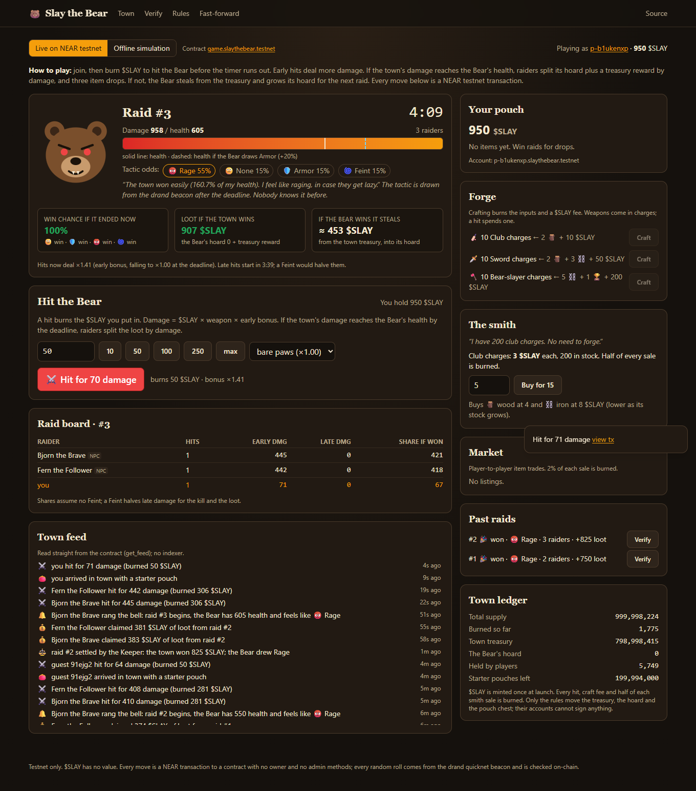
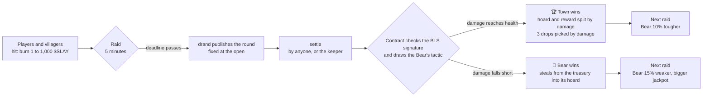
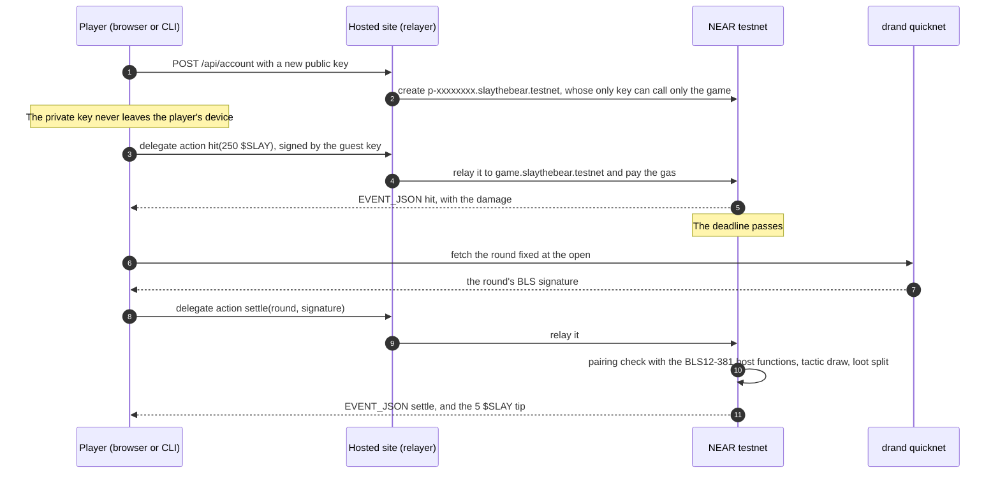

<p align="center">
  
</p>

<h1 align="center">Slay the Bear</h1>

<p align="center">
  <b>A memecoin you spend by fighting.</b><br />
  One NEAR contract holds the coin, the items and the rules. Every roll comes from the drand beacon and is checked on-chain.
</p>

<p align="center">
  <a href="https://testnet.nearblocks.io/address/game.slaythebear.testnet"></a>
  <a href="https://github.com/vibe-code-guy/slay-the-bear/actions/workflows/ci.yml"></a>
  
  
  
  
  
</p>

<p align="center">
  
</p>

Built for the NEAR HACKATHON. Tracks: `memecoins`, `games`.

**Play:** https://slay-the-bear.vercel.app · **Verify a raid:** https://slay-the-bear.vercel.app/verify ·
**Demo video:** _to be added_ · **Contract:** [`game.slaythebear.testnet`](https://testnet.nearblocks.io/address/game.slaythebear.testnet) (NEAR testnet)

## In one minute

- **Problem.** Most memecoins have nothing to do but sit in a chart. On-chain games ask players to
  trust whoever runs the dice.
- **Idea.** Make spending the coin the game. Every raid, the town burns $SLAY to hit a Bear before
  a five-minute timer runs out. The contract runs every rule, with no owner or admin methods. The
  dice come from drand, a public randomness beacon, and the contract checks drand's BLS
  signature itself.
- **Result.** Every raid ends in one of two outcomes, on-chain, and anyone can recompute it:

| Outcome | When | What happens |
| --- | --- | --- |
| 🏆 **Town wins** | The town's damage reaches the Bear's health, after the tactic the beacon drew | The raiders split the Bear's hoard and a treasury reward by damage, and get 3 item drops picked by damage. The next Bear is 10% tougher. |
| 🐻 **Bear wins** | The damage falls short | The Bear steals from the treasury into its hoard. The next raid's jackpot is bigger and the next Bear 15% weaker. |

47 raids have been played on testnet by 10 Nov 2026, and `npm run verify:game` recomputes every
one of them.

## Judge walkthrough: do X, see Y

**In a browser, no install, no wallet (about 6 minutes, most of it the raid's timer):**

| # | Do | See |
| --- | --- | --- |
| 1 | Open https://slay-the-bear.vercel.app and press **Play as a guest (free)** | A new testnet account `p-xxxxxxxx.slaythebear.testnet` and 1,000 $SLAY flying into your coin counter. No wallet, no gas prompt. A five-step tutorial points at each control. |
| 2 | Hold the red **HOLD** button about a second and let go | Your hero strikes; the longer you hold, the more $SLAY it burns, up to your **Max swing**. The damage number turns final when the transaction lands, and the toast's **view tx** opens it on nearblocks: a delegate action signed by your guest key, relayed by `slaythebear.testnet`. Your first hit opens the raid if none is on. |
| 3 | Watch the raid | The villagers (Bjorn, Fern, Sid, Sara) charging in, usually within a minute or two; Bjorn and Fern hit with swords. The win chance and the win/lose chip for each tactic update after every hit. |
| 4 | When the timer ends, press **Spin the Wheel of Fate** | The contract checks drand's signature; the wheel stops on the roll (out of 10,000) that drew the Bear's tactic. On a win, a loot chest with your drops and your share. If you don't spin, the keeper settles the raid within about a minute. |
| 5 | Press **Claim** | Your share of the loot flying to your coin counter. |
| 6 | Open https://slay-the-bear.vercel.app/verify | The latest settled raid recomputed in your browser: 13 of 13 checks pass, such as "drand signature is valid" and "Tactic drawn from the beacon: roll N of 10000". An orange line says the game account still has one access key ([lock status](#lock-status)). Type another raid number to check that one. |
| 7 | Open https://slay-the-bear.vercel.app/fast-forward and press **Run** | 90 days of raids simulated in a second: the win rate, the longest Bear streak, the Bear's health against the town's damage, the hoard and the burn. |
| 8 | Open the contract on [nearblocks](https://testnet.nearblocks.io/address/game.slaythebear.testnet) | The `hit`, `settle` and `claim` calls behind the steps above, from players, villagers and the keeper. |

**With a clone (Node 22+; Rust only for the contract tests):**

| # | Do | See |
| --- | --- | --- |
| 9 | `npm ci`, then `npm test` | `Tests 38 passed (38)`: the rules engine, the simulator, the verifier and the drand checks on real quicknet rounds. |
| 10 | `npm run test:contract` | `16 passed`, including a scripted game that the Rust contract replays and that must match the TypeScript rules exactly. |
| 11 | `npm run verify:game` (read-only, no keys) | `PASS code hash matches deployments/game.slaythebear.testnet.json`, a `NOTE` that the game account still has one key, `47 round(s), 47 settled` (or more), one `PASS round N: win, Rage (roll 7946), 3 raiders, 13 checks` line per raid, four ledger identities (supply + burned = minted, the loot chest, the treasury, the hoard), then `ALL PASS`. |
| 12 | `./slay sim demo` (`.\slay sim demo` in PowerShell) | A whole offline raid in about a second, command by command: two hits, a villager joining, the beacon's tactic, the loot, then `Raid #1 checks out: 13 of 13 checks pass.` |
| 13 | `./slay live join`, then `./slay live hit 100` | `Joined game.slaythebear.testnet as p-xxxxxxxx.slaythebear.testnet (a guest account; its key stays on this machine), with a 1,000 $SLAY starter pouch.`, then your hit's damage and its `Transaction: https://testnet.nearblocks.io/txns/...` link. Add `--json` for one JSON object. |
| 14 | `git checkout b9f0a5b`, `npm run build:contract:reproducible` (needs Docker), `git checkout main`, `npm run verify:live` | `PASS local build ... has hash BD2jeytg...`: the deployed code is your build of the commit named in the contract's NEP-330 metadata. Also `PASS config is the published "quick" preset`, and `FAIL access keys on the game account: 1` until the lock. |
| 15 | Read [docs/TESTNET.md](docs/TESTNET.md) | Every deployment and transaction on testnet: rejected tampered beacons, gas-free guest moves, the villagers' trades, raids played from the CLI and from the hosted site. |

## Guide for judges

| To check | Look at | Evidence |
| --- | --- | --- |
| It works on-chain | [`game.slaythebear.testnet`](https://testnet.nearblocks.io/address/game.slaythebear.testnet) | 47 raids by 10 Nov 2026, all recomputed by `npm run verify:game` (`ALL PASS`); every transaction in [docs/TESTNET.md](docs/TESTNET.md) |
| The game's rules | [`contracts/game/src/rules.rs`](contracts/game/src/rules.rs) (formulas), [`lib.rs`](contracts/game/src/lib.rs) (moves) | 16 contract tests in [`tests.rs`](contracts/game/src/tests.rs), [`drand.rs`](contracts/game/src/drand.rs) and [`rules.rs`](contracts/game/src/rules.rs) |
| The rolls can't be forged | [`contracts/game/src/drand.rs`](contracts/game/src/drand.rs): BLS12-381 verification with NEAR's host functions | A signature with one byte flipped and signatures of other rounds were rejected on testnet ([docs/TESTNET.md](docs/TESTNET.md#drand-verified-on-chain)); 6 TypeScript drand tests on real quicknet rounds in [`fixtures/`](fixtures) |
| Nobody knows the tactic early | The round fixed at the open, in [`rules.rs`](contracts/game/src/rules.rs) | `/verify`: "Deciding drand round fixed at the open: round N, published a few seconds after the deadline" |
| The TypeScript rules match the contract | [`packages/rules/src/engine.ts`](packages/rules/src/engine.ts), [`fixtures/vectors.json`](fixtures/vectors.json) | `npm run test:contract` replays the same scripted game in Rust and must agree |
| Every raid can be recomputed | [`packages/rules/src/verify.ts`](packages/rules/src/verify.ts) | 13 checks per raid in `/verify`, `npm run verify:game` and `slay verify` |
| The deployed code is this repository | [`deployments/game.slaythebear.testnet.json`](deployments/game.slaythebear.testnet.json), the contract's NEP-330 metadata | `npm run verify:live`; CI's `reproducible-build` job prints the code hash of every push |
| NPCs act by published rules | [`packages/rules/src/npc.ts`](packages/rules/src/npc.ts), [`packages/agents/src/villagers.ts`](packages/agents/src/villagers.ts) | The villagers' forges, listings and sales on testnet ([docs/TESTNET.md](docs/TESTNET.md#raids-10-to-38-the-villagers-trade-8-nov)) |
| The relayer can't play for a guest | [`apps/web/lib/server.ts`](apps/web/lib/server.ts) (`checkDelegate`) | [A relayed hit](https://testnet.nearblocks.io/txns/7kPY8zsduPvap28pGEvHxrAbBVAqAnLNLkWcMB75UqKq): the relayer sent it, the move inside is signed by the guest's key |
| AI agents can play | [`packages/cli`](packages/cli), [docs/CLI.md](docs/CLI.md) | Raid 44 played, settled and verified from the CLI ([docs/TESTNET.md](docs/TESTNET.md#raid-44-played-from-the-cli-10-nov)) |
| The numbers were tuned, not guessed | [`scripts/simulate.ts`](scripts/simulate.ts), [docs/GAME_DESIGN.md](docs/GAME_DESIGN.md) | A 60-day simulation of four kinds of town (`npm run simulate`), and `/fast-forward` |
| Threats considered | [docs/THREAT_MODEL.md](docs/THREAT_MODEL.md), [docs/FAIRNESS.md](docs/FAIRNESS.md) | 18 threats, each with its mitigation and what is left over |

AI reviewers: [`llms.txt`](llms.txt) sums up the project, its claims and where each one is
proven, in one file.

### Tracks

| Track | Track hint | Where Slay the Bear does it |
| --- | --- | --- |
| `memecoins` · Memecoins With Mechanics | A meme that does something: supply that reacts to the community, treasuries with rules, on-chain rituals and challenges; NEP-141 | $SLAY is NEP-141, minted once (80% to the treasury and the smith, 20% to starter pouches, no team allocation). Every raid is a public ritual whose result moves supply: hits, crafting, the smith and the market burn $SLAY (117,722 by raid 47). The treasury pays out only by rule, and the Bear's hoard grows when the town fails and pays out when it wins ([`rules.rs`](contracts/game/src/rules.rs)). |
| `games` · Games With Real Economies | NPCs with wallets, player-owned markets, economies that evolve without a dev patch, players who never notice the chain; NEP-245 | The Bear's hoard and the smith's float and stock are NPC wallets run by the contract; the villagers are NPC accounts ([`packages/agents`](packages/agents)). Players own NEP-245 items, craft them and trade them on a player market. Every raid adjusts the difficulty, the Bear's mood, the jackpot and the smith's prices. Guests never see a wallet or a gas prompt. Not used: social login (guests cover sign-in) and NEAR Intents (mainnet only). |

## How it works



A guest's hit and the settlement, step by step:



## The rules of a raid

| Step | Rule | Where you see it |
| --- | --- | --- |
| 1. Open | The first hit opens a raid. The open fixes the Bear's health, its *mood* and the drand round that will decide the raid: the first one published after the deadline, plus 2. | The raid number, the timer and the health bar appear. `/verify`: "Deciding drand round fixed at the open". |
| 2. Hit | Burn 1 to 1,000 $SLAY. Damage = $SLAY × weapon (1.25x to 2x) × early bonus (1.5x at the open, 1.0x at the deadline). The last 10% of the raid counts as late. | The damage number on the Bear, the early bonus under the timer, the win chance per tactic. |
| 3. Settle | After the deadline, anyone submits the deciding drand beacon and earns 5 $SLAY. The contract checks the signature, then draws the Bear's tactic: its mood with 55%, each other tactic with 15%. **Armor** adds 20% health, **Rage** makes a theft 50% bigger, **Feint** halves late hits, **None** does nothing. | The Wheel of Fate stops on the roll. `/verify`: "drand signature is valid", "Tactic drawn from the beacon". |
| 4. Win or lose | On a win, the raiders split the hoard plus a treasury reward by damage, and the beacon picks three drops (wood, iron or a rare Bear trophy) weighted by damage. On a loss, the Bear steals from the treasury into its hoard. | The loot chest and your share, then **Claim**. On a loss, the hoard pile beside the Bear grows. |

**The Bear adapts.** After a win it gets 10% tougher, after a loss 15% weaker, and its mood
reacts to how the town fought (many late hits → Feint). Above a 500 $SLAY floor, its health
never exceeds the town's best raid of the last six, and only half its hoard adds to its health.
So a losing town always faces a beatable Bear guarding a growing jackpot. Every number is on
[/rules](https://slay-the-bear.vercel.app/rules), and how they were chosen is in
[docs/GAME_DESIGN.md](docs/GAME_DESIGN.md).

<details>
<summary>Words used in the game</summary>

| Word | Meaning |
| --- | --- |
| $SLAY | The game's token (NEP-141). Testnet only, no value. Minted once: 1 billion. |
| Raid | One five-minute fight against the Bear. It opens with the first hit. |
| Hoard | The Bear's wallet. Its thefts go in, and the raiders of the next won raid get all of it. |
| Treasury | The contract's $SLAY reserve. It pays win rewards and settle tips, and the Bear steals from it. |
| Mood and tactic | The tactic is what the beacon draws at settlement: None, Armor, Rage or Feint. The mood is the tactic the Bear leans to: the beacon draws it 55% of the time. It follows from how the town fought the last raid. |
| Early bonus, late hits | A hit at the open deals 1.5x, falling to 1.0x at the deadline. Hits in the last 10% are late, and a Feint halves them. |
| Weapon charge | One charge per hit: club 1.25x, sword 1.5x, Bear-slayer 2x. Forged 10 at a time in the Forge (a Bear-slayer takes a trophy), and clubs are also sold by the smith. Without one you hit with bare paws, 1x. |
| Drops, trophies | Three drops per won raid, picked by the beacon weighted by damage: wood, iron, or (1 in 20) a one-of-one Bear trophy whose look comes from the raid's randomness. |
| drand | A public randomness beacon run by the League of Entropy. Its quicknet chain publishes a BLS signature every 3 seconds; randomness = sha256(signature). |
| Keeper | A bot account that settles finished raids nobody has settled, 15 seconds after the beacon. |
| Villagers | Bjorn the Brave, Fern the Follower, Sid the Sniper and Sara the Saver: NPC accounts that hit, forge and trade by published rules. |
| Smith | An NPC in the contract. It sells club charges and buys wood and iron, at prices set by its stock. |
| Guest | A free testnet account `p-xxxxxxxx.slaythebear.testnet`. Its only key stays in your browser (or the CLI) and can only call the game. |
| Relayer | The hosted site's server account. It creates guests and pays the gas of their moves. |

</details>

## The economy

| Who | Holds | Acts by |
| --- | --- | --- |
| **The Bear** | Its hoard | Contract rules: its health and mood follow the town's recent raids, and it steals on a loss |
| **The treasury** | 80% of the supply, shared with the smith | Contract rules only: win rewards, settle tips, thefts |
| **The smith** | A $SLAY float and a stock of clubs, wood and iron | Contract rules: prices move with its stock (20% up after a Bear win), and its forge runs at every raid's open |
| **The villagers** | Ordinary accounts with $SLAY and items | Published rules in [`npc.ts`](packages/rules/src/npc.ts): each has a personality for when and how hard to hit, and they forge weapons, list trophies and sell spare materials |
| **The keeper** | A little NEAR for gas | Settles a finished raid 15 seconds after its beacon if no player has |
| **Players** | $SLAY and NEP-245 items | Hit, settle, claim, craft, trade on the market (2% burned), buy from and sell to the smith |

The villagers and the keeper act when the hosted site's `/api/tick` runs: every 20 seconds while
a page is open, and every minute from a scheduled job. They use the same contract methods as
players and have no special powers.

## Why a raid can't be rigged

| Claim | How it holds | Check it |
| --- | --- | --- |
| The random rolls are drand's | `settle` verifies the BLS12-381 signature of the drand round fixed at the open, on-chain (NEP-488 host functions). | Tampered beacons rejected on testnet, [docs/TESTNET.md](docs/TESTNET.md#drand-verified-on-chain) |
| Nobody knows the Bear's tactic early | It is drawn from that beacon after the deadline. The Bear and the smith are rules in the contract, with no keys. | `/verify` "Tactic drawn from the beacon" |
| The rules can't change | No owner, no admin methods, config fixed at `new()`. The game account's last key is deleted at launch (**pending**, see below). | `npm run verify:game`, or `near account list-keys game.slaythebear.testnet network-config testnet now` |
| The code is this repository | Reproducible build with NEP-330 metadata pointing at the commit. | `npm run verify:live` |
| Every number follows the rules | The contract's views hold every input; the TypeScript rules (pinned to the contract by shared test vectors) recompute each raid and the ledger. | `npm run verify:game`, `/verify` |
| The server can't play for you | Guests sign moves on their own device; the relayer only pays gas and relays zero-deposit calls to game methods from guest accounts. | [docs/FAIRNESS.md](docs/FAIRNESS.md) |

Details and the remaining trust assumptions: [docs/FAIRNESS.md](docs/FAIRNESS.md) and
[docs/THREAT_MODEL.md](docs/THREAT_MODEL.md).

### Lock status

As of 10 Nov 2026, `game.slaythebear.testnet` still holds one full-access key, so its deployer
could still replace the code; `/verify`, `npm run verify:game` and `npm run verify:live` say so.
The key was used once, on 10 Nov, to replace the code with a reproducible build of the same
contract source whose embedded source link points at this repository; the state carried over
([docs/TESTNET.md](docs/TESTNET.md#instances)). Deleting the key is permanent, so it waits for
the owner: `npx tsx scripts/lock.ts --game game.slaythebear.testnet --confirm`. After that,
`/verify` shows "no access keys" and nobody can change the game.

## The app

One Next.js app at https://slay-the-bear.vercel.app. The town reads the contract straight from
NEAR RPC, and the scene only animates what the contract reports. Three server routes create
guests (`/api/account`), relay their moves (`/api/relay`) and wake the keeper and villagers
(`/api/tick`).

| Page or panel | What it is for |
| --- | --- |
| **Town** (`/`) | The raid: the Bear, the timer, the health bar with the win chance per tactic, the villagers, the Wheel of Fate, the strike button, today's goals |
| **Backpack** | Your hero and level, your $SLAY, weapon charges (pick the one to fight with), wood, iron and trophies |
| **Forge** | The three weapon recipes; forging burns the inputs |
| **Market** | Items players have put up for sale (the villagers sell trophies here); 2% of each sale is burned |
| **Smith** | Club charges for sale, and the prices the smith pays for wood and iron |
| **Trophies** | Every Bear trophy and who holds it |
| **Tavern** | The top slayers of the last 20 raids, the town feed, and past raids with **Verify** |
| **Guide** | The rules in a minute |
| **Live / Offline** switch | The testnet town, or a simulation in your browser with the same rules and a local beacon |
| [/verify](https://slay-the-bear.vercel.app/verify) | Any settled raid recomputed in your browser: 13 checks, plus the code hash and the access-key status |
| [/rules](https://slay-the-bear.vercel.app/rules) | Every number in the game's config |
| [/fast-forward](https://slay-the-bear.vercel.app/fast-forward) | 90 days of raids simulated in a second |

The wheel's segments are the mood odds from `get_config`, it stops at `roll / 10,000` of a turn
after the settlement is on chain, the loot chest shows the settlement's drops, and the levels,
goals, achievements and **Top slayers** are computed from the participants of the last 20
settled raids. Music is off until you press 🎵.

<table>
  <tr>
    <td width="33%"></td>
    <td width="33%"></td>
    <td width="33%"></td>
  </tr>
  <tr>
    <td align="center">Loot chest</td>
    <td align="center">Trophy Hall</td>
    <td align="center">/verify</td>
  </tr>
</table>

## Play from a terminal (people and AI agents)

`./slay` (`.\slay` in PowerShell, after `npm ci`) plays the same game: `slay sim` an offline town
with the same rules engine, `slay live` the testnet game. It prints plain text, or one JSON object
with `--json`, and every output ends with the moves that make sense next. Exit codes: 0 done, 1 a
failed move or check, 2 a usage error. Full reference: [docs/CLI.md](docs/CLI.md).

| Command | What it does |
| --- | --- |
| `slay help` | The rules in a minute and every command |
| `slay sim demo` | One whole offline raid, command by command |
| `slay sim new [--seed n]` | A fresh offline town; its clock moves only on `wait` |
| `slay live join` | A free guest through the hosted site's relayer (`--account you.testnet` uses your own key from `~/.near-credentials`) |
| `status` | The raid, you, the town and the suggested next moves |
| `hit <1-1000> [--weapon club\|sword\|slayer]` | Burn $SLAY to hit the Bear; the first hit opens a raid |
| `wait <seconds\|end>` | Let time pass and see what happened; `end` waits for the raid's beacon |
| `settle`, `claim` | Spin the Wheel of Fate; collect your loot |
| `me`, `craft`, `smith`, `market`, `sell`, `buy`, `cancel` | Your items, the Forge, the smith and the player market |
| `feed`, `raids`, `verify [raid]`, `rules` | The town feed, past raids, the 13 checks, every number of the config |

Each command after `slay sim` or `slay live` works the same in both modes.

## Try it

**Requirements:** Node 22+ and npm 10+ for everything; Rust and `cargo-near` only for the
contract tests and the wasm build; Docker only for the reproducible build. No keys are needed for
any of the checks.

### 1. Run the tests (no network needed)

```bash
npm ci
npm test                 # 38 tests: rules engine, simulator, verifier, drand
npm run test:contract    # 16 tests, including the TypeScript-to-Rust game replay
```

Expected: `Tests 38 passed (38)` and `test result: ok. 16 passed`. The contract test replays
[`fixtures/vectors.json`](fixtures/vectors.json), a scripted game the TypeScript rules wrote, and
must reach the same state.

### 2. Recheck the live game (read-only)

```bash
npm run verify:game
```

Expected: one `PASS round N` line per settled raid, four ledger identities and `ALL PASS`, with a
`NOTE` that the game account still has one key until the lock. Pass `-- --game <id>` to check
another instance.

### 3. Play a raid offline in the terminal

```bash
./slay sim demo                          # or, step by step:
./slay sim new --seed 42
./slay sim hit 300
./slay sim wait end
./slay sim settle
./slay sim verify
```

Expected: the demo ends with `Raid #1 checks out: 13 of 13 checks pass.` Step by step, each
command prints the raid and the next moves; the clock moves only on `wait`.

### 4. Play on testnet from the terminal

```bash
./slay live join            # a guest through the hosted relayer
./slay live hit 250
./slay live wait 60         # real time here; at most 900 seconds per call
./slay live status --json
```

Expected: the guest's account id and pouch, then your hit with its nearblocks link. Settle with
`./slay live wait end` then `./slay live settle` (the keeper does it within about a minute if
you don't), and collect with `./slay live claim`.

### 5. Run the web app locally

```bash
npm run demo                # http://localhost:3000
```

Expected: the live town, read straight from the testnet contract. Guest play needs the hosted
site's relayer, so a clone shows "has no relayer" when you press Play. Switch to **Offline**,
press **Start the simulation**, strike, then **⏭** (to the deadline) and **Spin the Wheel of
Fate**: a full raid with a local beacon, villagers included, and 13 green checks under the
Tavern's **Past raids**.

### 6. Check that the deployed code is this commit

```bash
git checkout b9f0a5b
npm run build:contract:reproducible   # needs Docker
git checkout main
npm run verify:live
```

Expected: `PASS local build ... has hash BD2jeytgDSV5wAyhNEfieVoFg3oqx9vedWuXZusPqdzN`, the
contract's NEP-330 source metadata naming commit `b9f0a5b`, `PASS config is the published "quick"
preset`, and `FAIL access keys on the game account: 1` until the lock.

### 7. Run your own instance

[docs/DEPLOY.md](docs/DEPLOY.md): faucet accounts, deploy and lock the contract, the keeper and
villagers, the web app on Vercel with its relayer, and the per-minute tick.

## NEAR features used

| NEAR feature | Used for | See it |
| --- | --- | --- |
| NEP-141 fungible token, with NEP-145 storage management | $SLAY | [An `ft_transfer` of 1 $SLAY](https://testnet.nearblocks.io/txns/9pxjcQPktotSuqeJcz4nFca1cbvgu19hue3PJjq5MCvf) on the dev instance |
| NEP-245 multi-token | Weapon charges, wood, iron and the one-of-one Bear trophies, in the same contract | [An `mt_transfer` of a club charge](https://testnet.nearblocks.io/txns/CJksEJDuMgr6mK13UMhY9i87XStcVv2CkjQgNCypD62Z); the Trophy Hall |
| BLS12-381 host functions (NEP-488) | Checking each drand signature inside `settle` | [Raid 44's settlement](https://testnet.nearblocks.io/txns/EeGLwt7djnfiGKCoDbpsJ4XaVXZdXbwUh6wm5xncRBpe); [`drand.rs`](contracts/game/src/drand.rs) |
| Meta transactions (NEP-366) and function-call access keys | Gas-free guests: a key that can only call the game signs each move, and the relayer pays the gas | [A guest's hit relayed by the hosted site](https://testnet.nearblocks.io/txns/7kPY8zsduPvap28pGEvHxrAbBVAqAnLNLkWcMB75UqKq) |
| Sub-accounts | Guest accounts `p-xxxxxxxx.slaythebear.testnet`, created by the relayer in one transaction | [A guest's creation](https://testnet.nearblocks.io/txns/cGg8EUr9hF9MvVZfEzT5ZJBiHWatwM9dLPJ1yq9QRVU): the account, 0.01 NEAR and the game-only key at once |
| NEP-297 events | Every move (hits, settlements, claims, crafting, trades) as `EVENT_JSON` logs; the site and the CLI read each hit's damage and each claim's payout from them | The logs of any transaction above |
| NEP-330 source metadata and reproducible builds | Proving that the deployed code is a given commit of this repository | `npm run verify:live` |
| Deleting the last access key | Making the contract unchangeable | Pending ([lock status](#lock-status)) |

## FAQ

**Do I need a wallet or NEAR?**
No. **Play as a guest** creates a testnet account whose only key is made in your browser and can
only call the game. The hosted site's relayer pays the gas. With your own testnet account you can
also play from the CLI (`slay live join --account you.testnet`).

**Is $SLAY worth anything? Is this gambling?**
No and no. It runs on testnet only, and $SLAY and the items have no value. Who wins a raid
follows from damage; the beacon only picks the Bear's tactic and the drops.

**Can the developer rig a raid?**
Not the rolls: they come from drand and the contract checks the signature. Not the rules: the
contract has no owner or admin methods, and its config is fixed. Until the lock, though, the
deployer's key could replace the contract's code; it was used once, to redeploy the same source
([lock status](#lock-status)). After the lock, nobody can change anything.

**What do the villagers do, and can they cheat?**
They are four ordinary accounts that hit, forge and trade by the rules in
[`npc.ts`](packages/rules/src/npc.ts), through the same contract methods as you. They act when the
site's `/api/tick` runs, and they only join raids that players start.

**What if nobody settles a raid?**
Anyone can settle a finished raid and earn the 5 $SLAY tip. If nobody does, the keeper settles it
15 seconds after the beacon, on the site's next tick (every minute at least).

**I played alone and the Bear won. Why?**
The Bear's health follows how the town has been doing: it grows after each win, up to the town's
best raid of the last six. One 1,000 $SLAY pouch deals about 1,500 damage at the open, more with
a weapon. The villagers usually join within a minute or two. After a loss the Bear is 15% weaker,
and its hoard, the next jackpot, is bigger.

**Can an AI agent play?**
Yes. `./slay` with `--json` prints one JSON object per command, with the whole game state and the
suggested next moves ([docs/CLI.md](docs/CLI.md)). [`llms.txt`](llms.txt) is a one-file map of
the project.

**Where are my items?**
On your account, as NEP-245 tokens in the game contract. The Backpack shows them; you can forge
with them or sell them at the market or to the smith. An account with its own full-access key can
also send them with `mt_transfer`.

## Repository layout

| Path | What |
| --- | --- |
| [`contracts/game/`](contracts/game) | The Rust contract (near-sdk 5.30). `lib.rs` holds the moves (`claim_pouch`, `hit`, `settle`, `claim`, `craft`, the market and the smith), `rules.rs` every formula, `drand.rs` the on-chain BLS check, `views.rs` the views every client reads, `standards.rs` NEP-141, NEP-145 and NEP-245, `tests.rs` the contract tests. |
| [`packages/rules/`](packages/rules) | The same rules in TypeScript (bigint math): `engine.ts` the game, `verify.ts` the 13 checks, `npc.ts` the NPC rules, `town.ts` the offline town, `sim.ts` the simulator, `drand.ts` the beacon. |
| [`packages/agents/`](packages/agents) | `keeper.ts` and `villagers.ts`, used by the web app's `/api/tick` and `npm run agents`. |
| [`packages/cli/`](packages/cli) | `slay`, the terminal client: `commands.ts` every command, `sim.ts` and `live.ts` the two modes. |
| [`apps/web/`](apps/web) | The Next.js app: the town, `/verify`, `/rules`, `/fast-forward`, and the `account`, `relay` and `tick` API routes. `lib/server.ts` creates guests and checks what the relayer may relay. |
| [`scripts/`](scripts) | Deploy, redeploy, lock, faucet, agents, `verify-game.ts`, `verify-live.ts`, the simulation, test vectors, end-to-end and UI checks in headless Chrome. |
| [`fixtures/`](fixtures) | Real drand quicknet rounds and the TypeScript-to-Rust vectors. |
| [`deployments/`](deployments) | The code hash and transactions of each testnet instance. |
| [`docs/`](docs) | [Game design](docs/GAME_DESIGN.md), [fairness](docs/FAIRNESS.md), [threat model](docs/THREAT_MODEL.md), [testnet log](docs/TESTNET.md), [deploying](docs/DEPLOY.md), [the terminal client](docs/CLI.md). |
| [`llms.txt`](llms.txt) | A one-file summary for AI reviewers. |
| [`.github/workflows/`](.github/workflows) | CI on every push: TypeScript (typecheck, tests, web build), the contract tests, and the reproducible build with its code hash. |

## Status

| Part | State |
| --- | --- |
| Contract | Done; 16 tests; deployed on testnet as a reproducible build of `b9f0a5b`; 47 raids played and verified by 10 Nov 2026 |
| Rules in TypeScript, simulator, verifier | Done; 38 tests; pinned to the contract by shared test vectors |
| Web app: town, `/verify`, `/rules`, `/fast-forward`, offline mode | Done; hosted at https://slay-the-bear.vercel.app until at least 25 Nov 2026; checked in headless Chrome, including that the game fits without scrolling at 12 window sizes |
| Gas-free guests (relayer) | Done; guests created and played from a browser and from the CLI on testnet |
| Keeper and villagers | Done; run by the site's `/api/tick`, every minute from a scheduled job and every 20 seconds per open page |
| Terminal client (`slay`) | Done; raids 44 and 45 played from it on testnet |
| Lock (deleting the last key) | Pending the owner's approval |
| Demo video | Not yet |
| Not built | NEAR Auth (Google or email) sign-in, wallet sign-in, mercenaries, a season-long leaderboard |

## Built with

No earlier project, template or own library was reused: the history starts on 7 Nov 2026 (UTC),
and there is no product on another chain. Third-party libraries and services:

| Part | Libraries |
| --- | --- |
| Contract (Rust) | `near-sdk` and `near-contract-standards` 5.30; tests: `serde_json`; built with `cargo-near` 0.22 in the `sourcescan/cargo-near:0.22.0-rust-1.99.1` image |
| Rules, agents, CLI (TypeScript) | `@noble/curves` and `@noble/hashes` 2.4 (BLS12-381, SHA-256), `near-api-js` 7.4, `tsx`; tests: Vitest 5 |
| Web app | Next.js 16, React 19, Tailwind CSS 4, `near-api-js` 7.4, `borsh`, ZzFX 1.4 (sound effects), `canvas-confetti` 1.9, the Web Audio API (music); the art, items and trophies are hand-written SVG |
| UI checks | `playwright-core` with the system Chrome |
| Services | NEAR testnet RPC (FastNEAR), the drand quicknet beacon (League of Entropy), Vercel (hosting), cron-job.org (the per-minute tick) |

## AI disclosure

Built with Kiro, an AI coding agent, which wrote the code, tests and docs under the author's
direction and review. Design decisions, testnet deployments and their results are recorded in
the commit history and [docs/TESTNET.md](docs/TESTNET.md).

## License

[MIT](LICENSE)
