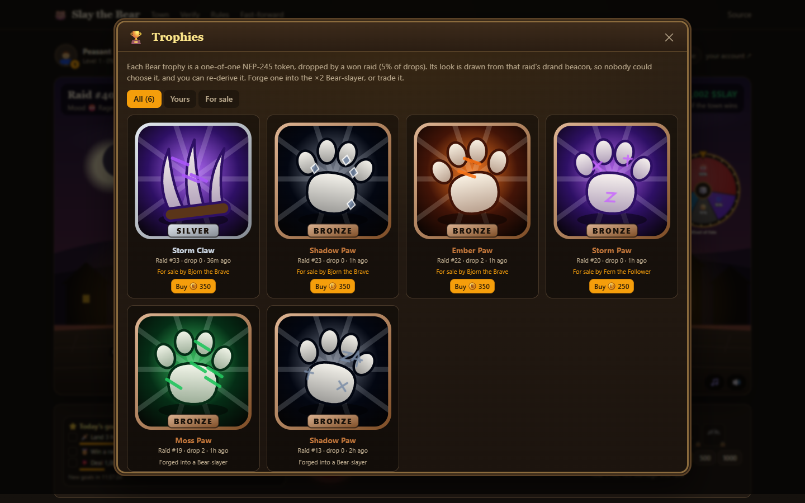
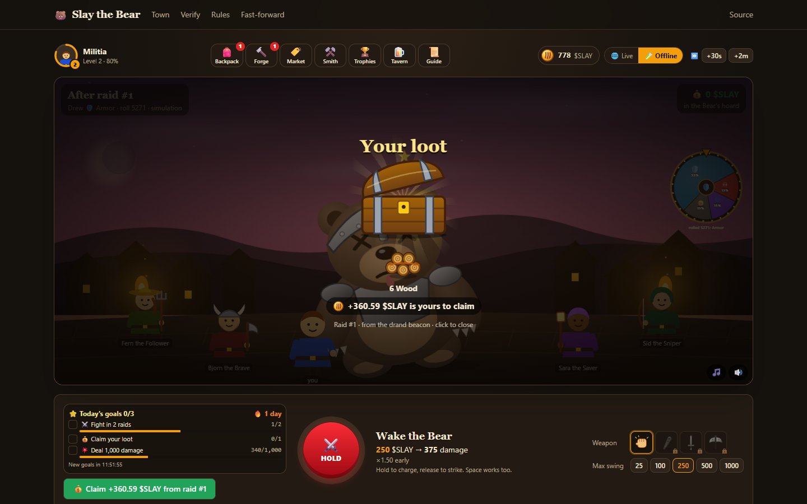

# Slay the Bear

A memecoin and a town game in one NEAR contract, on testnet. Players burn $SLAY to hit the Bear
before a five-minute timer runs out. If the town's damage reaches the Bear's health, the raiders
split the Bear's hoard and a treasury reward by damage. If not, the Bear steals from the
treasury, and the next raid's jackpot is bigger.

Most memecoins have nothing to do, and on-chain games ask players to trust whoever rolls the
dice. Here every move is a NEAR transaction that the contract checks, and every random roll
comes from the public drand beacon, whose BLS signature the contract verifies itself. Anyone can
recompute any raid from public data.

Built at NEAR HACKATHON for the **Memecoins With Mechanics** (`memecoins`) and **Games With Real
Economies** (`games`) tracks.

**[Play in the browser](https://slay-the-bear.vercel.app)** (a free guest account, no wallet) ·
**[Play in a terminal](#play-in-a-terminal-people-and-ai-agents)** ·
**[Check a raid](https://slay-the-bear.vercel.app/verify)** ·
**[Rules](https://slay-the-bear.vercel.app/rules)** ·
**[Testnet log](docs/TESTNET.md)**


| | |
| --- | --- |
| Hosted demo | [slay-the-bear.vercel.app](https://slay-the-bear.vercel.app), online through judging (until at least 25 Nov 2026) |
| Live contract (testnet) | [`game.slaythebear.testnet`](https://testnet.nearblocks.io/address/game.slaythebear.testnet) |
| Deployed code | A reproducible build of commit [`b9f0a5b`](https://github.com/vibe-code-guy/slay-the-bear/tree/b9f0a5b069b33442d04bb6c8e21fa92f3680d64a), code hash `BD2jeytgDSV5wAyhNEfieVoFg3oqx9vedWuXZusPqdzN` |
| Played so far | 47 raids by 10 Nov 2026, each one recomputed by `npm run verify:game` ([docs/TESTNET.md](docs/TESTNET.md)) |
| Video | _to be added_ |

## Contents

1. [Play in the browser](#play-in-the-browser)
2. [Play in a terminal (people and AI agents)](#play-in-a-terminal-people-and-ai-agents)
3. [Run and check it from a clone](#run-and-check-it-from-a-clone)
4. [How a raid works](#how-a-raid-works)
5. [Words used here](#words-used-here)
6. [Why a raid can't be rigged](#why-a-raid-cant-be-rigged)
7. [How NEAR is used](#how-near-is-used)
8. [Track fit](#track-fit)
9. [Repository map](#repository-map)
10. [Limits](#limits)
11. [Built with, AI disclosure, hackathon window and license](#built-with)

## Play in the browser

Open [slay-the-bear.vercel.app](https://slay-the-bear.vercel.app). There is nothing to install.

| Do | See |
| --- | --- |
| Press **Play as a guest (free)** on the title screen | A new testnet account `p-xxxxxxxx.slaythebear.testnet`; 1,000 $SLAY fly into your coin counter. No wallet, no gas prompt. A five-step tutorial points at each control during your first raid. |
| Hold the red **HOLD** button and let go (or hold Space) | Your hero leans back in a growing glow while you hold; the longer you hold, the more $SLAY the strike burns, up to your **Max swing**. The hero lunges, the damage number flies off the Bear and turns final when the transaction lands. The toast links the transaction on nearblocks. |
| Watch the villagers (Bjorn, Fern, Sid, Sara) | NPC raiders charging in by their published rules, wearing the gear of their levels, with the **win chance** and the win/lose chip for each tactic updating after every hit. In the last ten seconds the Bear rears up and the scene's edges glow red. |
| When the timer ends, press **Spin the Wheel of Fate** | The wheel spins while the contract checks the drand signature, then stops on the roll (out of 10,000) that drew the Bear's tactic. On a win, a loot chest opens with the drops the beacon gave you and your share; a Bear trophy gets its own reveal. A level gained shows next, then your goals and achievements. If nobody spins, the keeper settles the raid within about a minute. |
| Press **Claim** | Your share of the loot flies to your coin counter. |
| In the **Tavern**, open **Past raids** and press **Verify**, or open [/verify](https://slay-the-bear.vercel.app/verify) | 13 checks recomputed in your browser from the contract's views and the drand beacon, all green. |

Where things are:

| Place | What it holds |
| --- | --- |
| **Backpack** | Your hero and level, your $SLAY, weapon charges (pick the one to fight with), wood, iron and trophies |
| **Forge** | The three weapon recipes; forging burns the inputs |
| **Market** | Items players have put up for sale (the villagers sell trophies here); 2% of each sale is burned |
| **Smith** | Club charges for sale, and the prices the smith pays for wood and iron |
| **Trophies** | Every Bear trophy and who holds it |
| **Tavern** | The top slayers of the last 20 raids, the town feed, and past raids with **Verify** |
| **Guide** | The rules in a minute |
| **Live / Offline** switch | The testnet town, or a simulation in your browser with the same rules and a local beacon |
| [/verify](https://slay-the-bear.vercel.app/verify) | Any settled raid, recomputed in your browser: 13 checks |
| [/rules](https://slay-the-bear.vercel.app/rules) | Every number in the game's config |
| [/fast-forward](https://slay-the-bear.vercel.app/fast-forward) | 90 days of raids, simulated in a second: win rate, longest Bear streak, health against damage, the hoard and the burn |

The scene only animates what the contract reports. The wheel's segments are the mood odds from
`get_config`, it stops at `roll / 10,000` of a turn after the settlement is on chain, the loot
chest shows the settlement's drops, and the levels, goals, achievements and **Top slayers** are
computed from the participants of the last 20 settled raids. Music is off until you press 🎵.



## Play in a terminal (people and AI agents)

Clone the repository and run `npm install` (Node 22+). Then `./slay` (`.\slay` in PowerShell)
plays the same game: `slay sim` an offline town with the same rules engine, `slay live` the
testnet game. It prints plain text, or one JSON object with `--json`, and every output ends with
the moves that make sense next. Commands, the JSON and timing: [docs/CLI.md](docs/CLI.md).

| Do | See |
| --- | --- |
| `./slay help` | The rules in a minute and every command. |
| `./slay sim demo` | A whole offline raid, command by command: your hits, a villager joining, the beacon's tactic, the loot and 13 passing checks. |
| `./slay sim hit 300`, `./slay sim wait end`, `./slay sim settle`, `./slay sim verify` | Your own offline raid. The clock moves only when you `wait`. |
| `./slay live join`, then `./slay live hit 250` | A guest account on testnet, made through the hosted site's relayer, with its 1,000 $SLAY pouch; then a hit and its transaction on nearblocks. `--account you.testnet` plays as your own account instead. |
| `./slay live status --json` | The raid, you, the town and the suggested next moves, as one JSON object. |
| `./slay live verify --json` | The 13 checks of the last settled raid on `game.slaythebear.testnet`, as JSON. |

## Run and check it from a clone

Needs Node 22+, and Rust for the contract tests (`cargo-near` only to build the wasm). No keys
are needed.

```bash
npm install
npm test                     # 38 TypeScript tests: rules, simulator, verifier
npm run test:contract        # 16 Rust tests, including the TypeScript-to-Rust game replay
npm run verify:game          # recomputes every settled raid on game.slaythebear.testnet: PASS lines
npm run demo                 # the web app at http://localhost:3000
npm run simulate             # the economy simulation; open sim-out/report.html
```

| Do | See |
| --- | --- |
| `npm run verify:game` | `PASS round 1: win, Rage (roll 7622), 2 raiders, 13 checks` and a line like it for every raid, then four ledger identities and `ALL PASS`. |
| `npm run demo`, open http://localhost:3000 | The live town, read straight from the testnet contract. Guest play needs the hosted site's relayer, so a clone shows "has no relayer" when you press Play. |
| Switch to **Offline**, press **Start the simulation**, strike, then **⏭** (to the deadline) and **Spin the Wheel of Fate** | A full raid with the same rules engine and a local beacon, villagers included. **Verify** under the Tavern's **Past raids** shows 13 green checks. |
| `git checkout b9f0a5b`, `npm run build:contract:reproducible` (needs Docker), `git checkout main`, `npm run verify:live` | The deployed code hash equals your reproducible build of the commit named in the contract's metadata. |

## How a raid works

1. **Open.** The first hit opens a raid. The open fixes the Bear's health, its *mood* and the
   drand round that will decide the raid: the first one published after the deadline, plus 2.
2. **Hit.** Burn 1 to 1,000 $SLAY. Damage = $SLAY × weapon (1.25x to 2x) × early bonus (1.5x at
   the open, 1.0x at the deadline). The last 10% of the raid counts as late.
3. **Settle.** After the deadline, anyone submits the deciding drand beacon and earns 5 $SLAY.
   The contract checks the signature, then draws the Bear's tactic: its mood with 55%, each
   other tactic with 15%. **Armor** adds 20% health, **Rage** makes a theft 50% bigger,
   **Feint** halves late hits, **None** does nothing.
4. **Win or lose.** On a win, raiders split the hoard plus a treasury reward by damage, and the
   beacon picks three drops (wood, iron or a rare Bear trophy) weighted by damage. On a loss,
   the Bear steals from the treasury.

The Bear adapts. After a win it gets 10% tougher, after a loss 15% weaker, and its mood reacts
to how the town fought (many late hits → Feint). Above a 500 $SLAY floor, its health never
exceeds the town's best raid of the last six, and only half its hoard adds to its health. So a
losing town always faces a beatable Bear guarding a growing jackpot. The numbers come from a
simulation of four kinds of town ([docs/GAME_DESIGN.md](docs/GAME_DESIGN.md)).

Around the raid: weapons, materials and trophies are NEP-245 items in the same contract. Players
craft (fees burned), trade on a player market (2% burned) and deal with the smith NPC, whose
prices move with its stock and whose forge runs at every raid's open. The villagers use the same
moves with their own drops: they forge weapons when their charges run out, put trophies up at
the market and sell spare wood and iron to the smith (`villagerTrade` in
`packages/rules/src/npc.ts`). Each Bear trophy's look (kind, element, grade, marks) is derived
from its raid's drand randomness, so nobody picks it and anyone can recompute it
(`scripts/trophy-check.ts`); it is cosmetic, and on-chain all trophies are equal.



## Words used here

| Word | Meaning |
| --- | --- |
| $SLAY | The game's token (NEP-141). Testnet only, no value. Minted once: 1 billion. |
| Raid | One five-minute fight against the Bear. It opens with the first hit. |
| Hoard | The Bear's wallet. Its thefts go in, and the raiders of the next won raid get all of it. |
| Treasury | The contract's $SLAY reserve. It pays win rewards and settle tips, and the Bear steals from it. |
| Mood and tactic | The tactic is what the beacon draws at settlement: None, Armor, Rage or Feint. The mood is the tactic the Bear leans to: the beacon draws it 55% of the time. It follows from how the town fought the last raid (many late hits make it Feint). |
| Early bonus, late hits | A hit at the open deals 1.5x, falling to 1.0x at the deadline. Hits in the last 10% are late, and a Feint halves them. |
| Weapon charge | One charge per hit: club 1.25x, sword 1.5x, Bear-slayer 2x. Forged 10 at a time in the Forge (a Bear-slayer takes a trophy), and clubs are also sold by the smith. Without one you hit with bare paws, 1x. |
| Drops, trophies | Three drops per won raid, picked by the beacon weighted by damage: wood, iron, or (1 in 20) a one-of-one Bear trophy. |
| drand | A public randomness beacon run by the League of Entropy. Its quicknet chain publishes a BLS signature every 3 seconds; randomness = sha256(signature). |
| Settle, Wheel of Fate | Submitting the deciding drand round after the deadline. The contract checks it, then draws the tactic and the drops. |
| Keeper | A bot account that settles finished raids nobody has settled, 15 seconds after the beacon. |
| Villagers | Bjorn the Brave, Fern the Follower, Sid the Sniper and Sara the Saver: NPC accounts that hit, forge and trade by published rules. |
| Smith | An NPC in the contract. It sells club charges and buys wood and iron, at prices set by its stock. |
| Guest | A free testnet account `p-xxxxxxxx.slaythebear.testnet`. Its only key stays in your browser (or the CLI) and can only call the game. |
| Relayer | The hosted site's server account. It creates guests and pays the gas of their moves. |

## Why a raid can't be rigged

| Claim | How it holds | Check it |
| --- | --- | --- |
| The random rolls are drand's | `settle` verifies the BLS12-381 signature of the drand round fixed at the open, on-chain (NEP-488 host functions). | Tampered beacons rejected on testnet, [docs/TESTNET.md](docs/TESTNET.md) |
| Nobody knows the Bear's tactic early | It is drawn from that beacon after the deadline. The Bear and the smith are rules in the contract, with no keys. | `/verify` "Tactic drawn from the beacon" |
| The rules can't change | No owner, no admin methods, config fixed at `new()`. The game account's last key is deleted at launch (**pending the owner's approval**, see below). | `near account list-keys game.slaythebear.testnet network-config testnet now` |
| The code is this repository | Reproducible build with NEP-330 metadata pointing at the commit. | `npm run verify:live` |
| Every number follows the rules | The contract's views hold every input; the TypeScript rules (pinned to the contract by shared test vectors) recompute each raid and the ledger. | `npm run verify:game`, `/verify` |
| The server can't play for you | Guests sign moves in the browser; the relayer only pays gas and relays zero-deposit game calls. | [docs/FAIRNESS.md](docs/FAIRNESS.md) |

Details and the remaining trust assumptions: [docs/FAIRNESS.md](docs/FAIRNESS.md) and
[docs/THREAT_MODEL.md](docs/THREAT_MODEL.md).


**Lock status (10 Nov 2026).** `game.slaythebear.testnet` still holds one full-access key, so
its deployer could still replace the code; `/verify` and `npm run verify:game` say so. The code
was last replaced on 10 Nov by a reproducible build of the same contract source, to update its
source link, and the state carried over ([docs/TESTNET.md](docs/TESTNET.md#instances)). Deleting
the key is permanent, so it waits for the owner: `npx tsx scripts/lock.ts --game
game.slaythebear.testnet --confirm` deletes it, and `/verify` then shows "no access keys".

## How NEAR is used

| NEAR feature | Used for |
| --- | --- |
| NEP-141 fungible token, with NEP-145 storage management | $SLAY |
| NEP-245 multi-token | Weapon charges, wood, iron and the one-of-one Bear trophies, in the same contract |
| BLS12-381 host functions (NEP-488) | Verifying each drand signature inside `settle` |
| Meta transactions (NEP-366) and function-call access keys | Gas-free guests: a key that can only call the game signs each move, and the relayer pays the gas |
| Sub-accounts | Guest accounts `p-xxxxxxxx.slaythebear.testnet`, created by the relayer in one transaction |
| NEP-297 events | Every move (hits, settlements, claims, crafting, trades) as `EVENT_JSON` logs; the site and the CLI read each hit's damage and each claim's payout from them |
| NEP-330 source metadata and reproducible builds | Proving that the deployed code is a given commit of this repository |
| Deleting the last access key | Making the contract unchangeable (pending, see the lock status above) |

## Track fit

**Memecoins With Mechanics.** The mechanic is in the contract, not a backend: $SLAY is NEP-141,
minted once (80% to the treasury and the smith, 20% to starter pouches, no team allocation), and
every raid is a public ritual whose result moves supply. Hits, crafting, the smith and the
market burn $SLAY; the treasury pays out only by rule; the Bear's wallet grows when the
community fails and is paid out when it succeeds. All parameters are readable with
`get_config`, and a 60-day simulation of four community behaviours chose them. Track hints used:
memecoins, token mechanics, NEP-141.

**Games With Real Economies.** NPCs with wallets (the Bear's hoard, the smith's float and stock)
act by rules in the contract; villager NPCs play and trade with ordinary accounts: on testnet
they have forged Bear-slayers from their trophies and put others up for sale
([docs/TESTNET.md](docs/TESTNET.md)). Players own their items (NEP-245), craft them, trade them
on a player market and sell materials to the smith. The economy adjusts itself every raid:
difficulty, the Bear's mood, the jackpot and smith prices, with no dev patch. Guests never see a
wallet or a gas prompt. Track hints used: agent NPCs, NEP-245, players who never notice the
chain. Not used: social login (guests cover sign-in) and NEAR Intents (mainnet only).

## Repository map

| Path | What |
| --- | --- |
| `contracts/game` | The Rust contract (near-sdk 5.30): $SLAY (NEP-141 + NEP-145), items (NEP-245), raids, drand verification, the Bear, the smith, the market, the feed, views |
| `packages/rules` | The same rules in TypeScript (bigint math): engine, NPC rules (`npc.ts`), the offline town (`town.ts`), simulator, view JSON, verifier |
| `packages/agents` | The keeper (settles finished raids) and the villagers, used by the web app and `npm run agents` |
| `packages/cli` | `slay`, the terminal client: the offline town or the testnet game, as text or JSON ([docs/CLI.md](docs/CLI.md)) |
| `apps/web` | Next.js app: the town, `/verify`, `/rules`, `/fast-forward`, and the guest, relay and tick API routes |
| `scripts/` | Deploy, redeploy, lock, faucet, agents, end-to-end and UI checks, `verify-game`, `verify-live`, simulation, test vectors |
| `fixtures/` | Real drand quicknet rounds and the TypeScript-to-Rust vectors |
| `deployments/` | Code hash and transactions of each testnet instance |
| `docs/` | [Game design](docs/GAME_DESIGN.md), [fairness](docs/FAIRNESS.md), [threat model](docs/THREAT_MODEL.md), [testnet log](docs/TESTNET.md), [deploying](docs/DEPLOY.md), [the terminal client](docs/CLI.md) |
| `llms.txt` | A short map of the project for AI agents |

Other commands:

| Command | What it does |
| --- | --- |
| `npm run typecheck` | Type-checks every package and the web app |
| `npm run fast-forward` | A week of raids in the terminal |
| `npm run vectors` | Regenerates the TypeScript-to-Rust test vectors |
| `npm run build:contract` | Builds the contract's wasm (cargo-near) |
| `npm run status -- --game <id>` | A game's state in the terminal |
| `npm run agents -- --game <id>` | Runs the keeper and the villagers (needs their keys) |
| `npm run test:ui -- --url <site> [--live]` | Drives a running site in headless Chrome |
| `npm run test:fit -- --url <site>` | Checks that the HUD, the scene and the strike button fit without scrolling at 12 window sizes, from a phone held sideways to a desktop |
| `npx tsx scripts/ui-game.ts`, `ui-tour.ts`, `ui-moods.ts`, `ui-readme.ts` | A raid, every panel, the Bear's moods and the README screenshots, in headless Chrome |

Running your own instance, relayer and hosted site: [docs/DEPLOY.md](docs/DEPLOY.md).

## Limits

- **Testnet only.** $SLAY and the items have no value. This is not a gambling product: who wins a
  raid follows from damage, and the beacon only picks the tactic and the drops.
- **Relayer.** It can refuse to relay. Guests without NEAR depend on it; anyone with testnet NEAR
  can call the contract directly.
- **drand.** A threshold of League of Entropy members could predict a beacon together.
- **Validators.** A validator would have to hold block timestamps back by more than the 6-second
  margin to sneak in a hit with the beacon known.
- **Fake accounts.** Splitting $SLAY across accounts gains nothing in a raid, and pouches are
  capped at 200 a day, but a farmer can collect pouches within the cap.
- **Storage.** The contract pays for its state; anyone can top it up by sending it NEAR.
- **Not built:** NEAR Auth (Google or email) sign-in, NEAR wallet sign-in, mercenaries and a
  season-long leaderboard (the town ranks the last 20 raids). Guests and direct contract calls
  cover sign-in.

## Built with

near-sdk and near-contract-standards 5.30, cargo-near 0.22 (reproducible build image
`sourcescan/cargo-near:0.22.0-rust-1.99.1`), near-api-js 7.4, borsh, @noble/curves and
@noble/hashes 2.4 (BLS12-381 and SHA-256 in TypeScript), Next.js 16, React 19, Tailwind CSS 4,
ZzFX 1.4 (sound effects), the Web Audio API (the optional music), canvas-confetti 1.9, Vitest 5,
tsx, playwright-core (UI checks only), and the drand quicknet beacon run by the League of
Entropy. The town's art, items and trophies are hand-written SVG. The site is hosted on Vercel,
and a cron-job.org job calls its `/api/tick` every minute so finished raids settle when no page
is open.

## AI disclosure

Built with Kiro, an AI coding agent, which wrote the code, tests and docs under the author's
direction and review. Design decisions, testnet deployments and their results are recorded in
the commit history and [docs/TESTNET.md](docs/TESTNET.md).

## Hackathon window

All code here was written during NEAR HACKATHON: the history starts on 7 Nov 2026 (UTC), and
there is no earlier code base and no product on another chain.

## License

[MIT](LICENSE)
